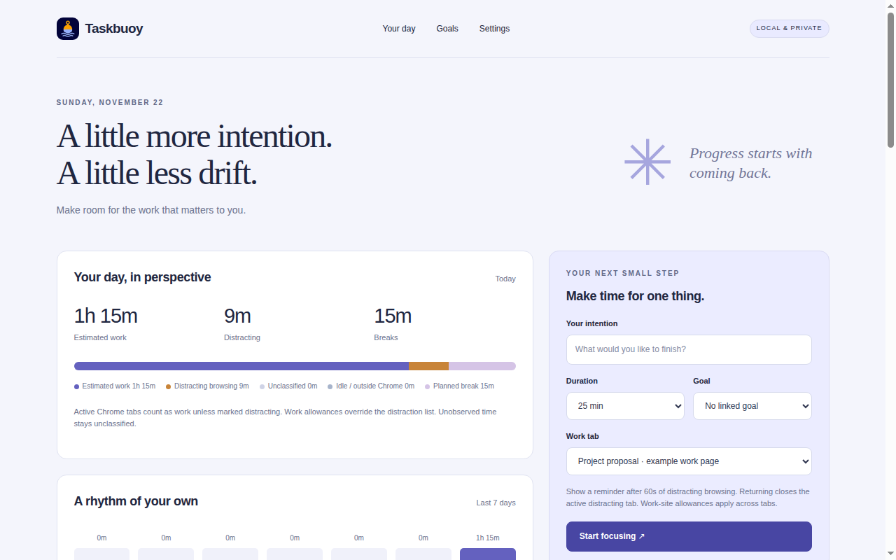

# Taskbuoy

*A little more intention. A little less drift.*

A **local Chrome extension** for the “just one more video” moments. Choose what you want to work on, set your boundaries, and let Taskbuoy help you come back.

**Currently under review on the Chrome Web Store.** You can install it locally in the meantime.



*Actual interface with illustrative demo records.*

## What it does

- **Start with intention.** Review your settings before each session starts: distracting sites, work allowances, timers, sound, and return mode.
- **Catch the drift.** Get an on-page countdown, visible reminders, and optional chimes. Choose gentle nudges or automatic return to your work tab, with optional closure of the active distracting tab.
- **See your rhythm.** Review estimated work time, distracting browsing, session reflections, and progress toward your goals.
- **Make it yours.** Configure a motivational video or enable experimental, on-device camera cues.

Unmarked active Chrome tabs count as work. Tracking works across Chrome windows; other desktop apps are outside its scope.

## Try it locally

```sh
git clone https://github.com/hibaa8/focus-coach.git
```

1. Open `chrome://extensions` and enable **Developer mode**.
2. Click **Load unpacked** and select `focus-coach/extension`.
3. Pin Taskbuoy, open a work website, and start a session.

No build, server, account, or API key required. To update, run `git pull`, reload the extension, and refresh your website tabs.

## Your time stays yours

Records stay in your Chrome profile. Camera processing is optional and local; frames are not recorded or uploaded. Camera cues are estimates, and work-time totals reflect browser activity.

Motivational videos connect to the hosted player and YouTube. Playback depends on YouTube’s embedding restrictions and browser autoplay settings.

## For builders

Run `npm test` for the automated suite.

[Privacy policy](extension/privacy.html) · [Release notes & known limits](store/final-release-notes.txt) · [Browser checks](https://github.com/hibaa8/focus-coach/actions/runs/45057715604)
